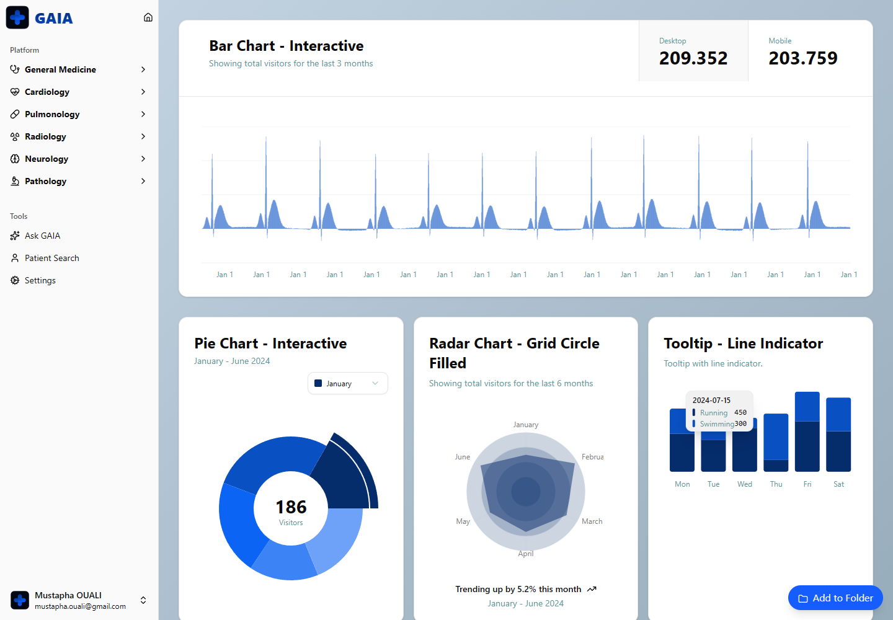
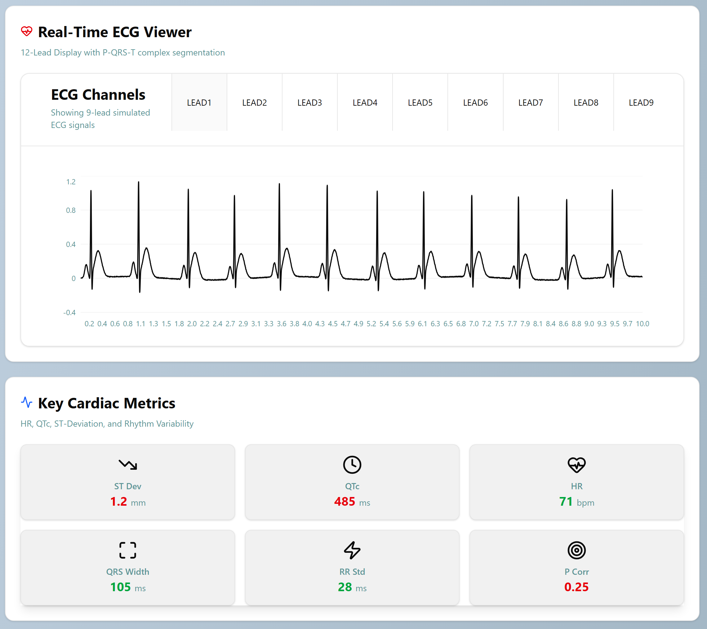
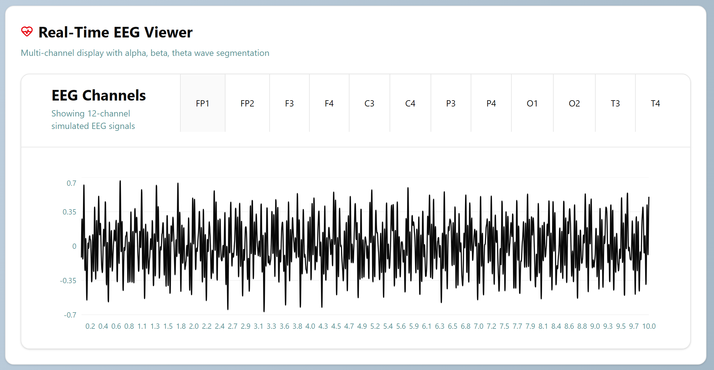

<h1 style="font-family: Arial, sans-serif; font-size: 36px; color: #5FA8F5; display: flex; align-items: center; gap: 12px; border-bottom: 3px solid #5FA8F5; padding-bottom: 8px;">
  
  GAIA - AI4HEALTH Desktop Platform
</h1>

GAIA (AI4HEALTH) is a desktop-first health-tech project built with **Tauri + React + TypeScript + Vite**.
It pairs a multi-specialty clinical dashboard with a small Python server that generates the ECG and EEG signals the dashboard plots.

---

## Screenshot

<p align="center">
  
</p>

---

## Tech Used


---

## Architecture

```text
React dashboard (Vite, port 1420)          Flask signal server (server/, port 5600)
  ECG page ── GET /api/ecg every 10 s ──►    signals/ecg.py  9-lead ECG + HR, R-R spread
  EEG page ── GET /api/eeg every 10 s ──►    signals/eeg.py  12-channel EEG + band powers
  Chat page ── POST /api/chat ──────────►    chat.py  forwards to Groq (key stays server-side)
Tauri shell (src-tauri/) wraps the React app; it does not start the Python server.
```

```text
src/                 React UI (routes, chart components, signal API client)
server/              Flask API: ECG/EEG generators, Groq chat proxy, pytest tests
src-tauri/           Tauri v2 shell and capabilities
```

### Signal server

`server/` generates synthetic physiological signals on request. Each call returns a fresh 10-second window at 250 Hz, plus values measured back from that window:

| Endpoint | Returns | Measured from the signal |
| --- | --- | --- |
| `GET /api/health` | `{"status": "ok", "chat": true}` (`chat` is false when no Groq key is set) | |
| `GET /api/ecg` | 9 leads, 2500 samples | heart rate and R-R standard deviation, from R-peak detection on lead 1 |
| `GET /api/eeg` | 12 channels (Fp1 to T4), 2500 samples | alpha/beta power ratio, relative theta and delta power, channel RMS variability, from an FFT |

Query parameters, all optional: `duration` (1-60 s), `fs` (100-1000 Hz), `seed` (repeatable output), and for ECG `hr` (30-200 bpm) and `hrv` (R-R jitter in ms). Out-of-range values get a 400 with an `error` message. CORS is open only to the Vite dev server and the Tauri webview origins.

The generators are adapted from **AI4health**, the synthetic ECG/EEG waveform generator written for this project (a local scratch folder, not published). The beat and band models are unchanged; the port returns arrays instead of writing JS files, adds a seedable RNG, and jitters each beat's R-R interval so heart-rate variability is measurable.

### What is live and what is static

Live, from the signal server:

- ECG Interpretation (Cardiology > ECG AI): the waveform viewer, and HR and RR Std in Key Cardiac Metrics.
- EEG Pattern Recognition (Neurology > EEG AI): the waveform viewer and all four Key Brain Metrics.

If the server is down, those cards say "Signal server is not reachable" instead of showing data.

Still static demo content:

- On the ECG page: ST Dev, QTc, QRS Width and P Corr (the generator does not model those intervals), the events list, ST-segment, tachycardia, trend, lead map, signal-quality and lab-test cards.
- On the EEG page: everything below Key Brain Metrics.
- Every other view: home statistics, patients, general medicine, pathology, pulmonology, radiology, monitoring, cognition, and the image tabs. None of them make network calls; there is no ML model behind them.

### Chat

The Chat page (Ask GAIA) is the only feature that calls an AI model. The browser posts the conversation to `POST /api/chat`. The server adds a system prompt and forwards the last 12 turns to Groq's chat completions API. The default model is `openai/gpt-oss-120b`; set `GROQ_MODEL` to change it. The system prompt also lists the pages pinned with "Add to Folder", with an instruction to assume results exist for them.

The key lives in `server/.env` as `GROQ_API_KEY` (see `server/.env.example`). That file is gitignored and only the Python server reads it, so the key is never in the frontend bundle. Without a key, `/api/chat` returns 503 and the page shows a notice with Send disabled. It shows a different notice when the server isn't running.

---

## Getting Started

Signal server (Python 3.11+):

```bash
cd server
python -m venv .venv
source .venv/Scripts/activate   # Git Bash; .venv/bin/activate on macOS/Linux
pip install -r requirements.txt
python app.py                 # serves http://127.0.0.1:5600
```

Dashboard, in a second terminal:

```bash
pnpm install
pnpm dev          # browser at http://localhost:1420
pnpm tauri dev    # or the desktop app
```

Chat needs a Groq key in `server/.env` (create a key at console.groq.com):

```bash
GROQ_API_KEY=your-key
```

Optional `.env.local` at the repo root, if the server runs elsewhere:

```bash
VITE_SIGNAL_API_URL=http://127.0.0.1:5600
```

Server tests:

```bash
cd server
python -m pytest
```

---

## Live signal views

<p align="center">
  
</p>

<p align="center">
  
</p>

---

## Available Scripts

```bash
pnpm start      # tauri dev
pnpm dev        # vite dev server
pnpm build      # frontend build
pnpm preview    # preview frontend build
pnpm tauri      # tauri CLI
```
