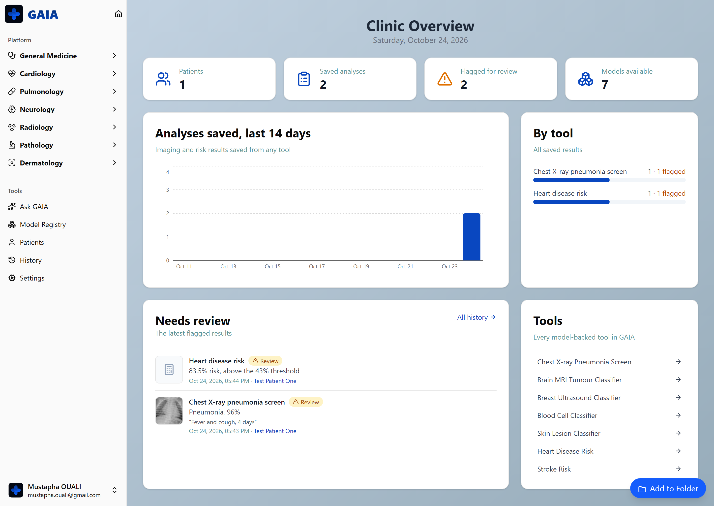
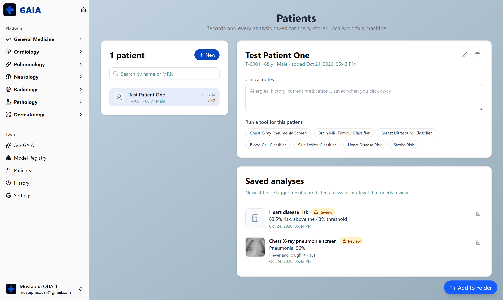
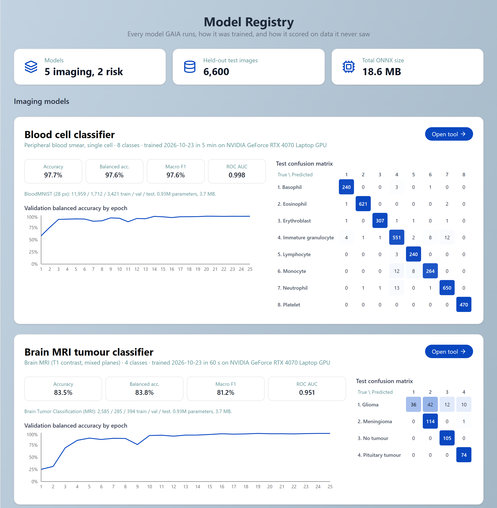
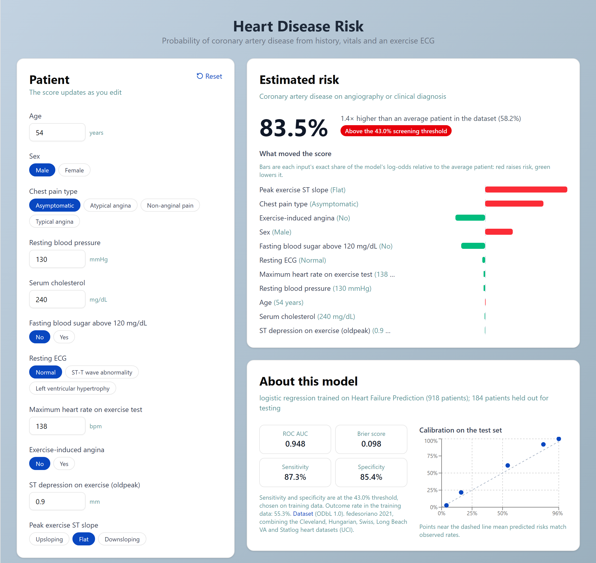

<h1 style="font-family: Arial, sans-serif; font-size: 36px; color: #5FA8F5; display: flex; align-items: center; gap: 12px; border-bottom: 3px solid #5FA8F5; padding-bottom: 8px;">
  
  GAIA - AI4HEALTH Desktop Platform
</h1>

GAIA (AI4HEALTH) is a desktop-first health-tech project built with **Tauri + React + TypeScript + Vite**.
It pairs a multi-specialty clinical dashboard with a small Python server that generates the ECG and EEG signals the dashboard plots.

---

## Screenshot

<p align="center">
  
</p>

---

## Tech Used


---

## Architecture

```text
React dashboard (Vite, port 1420)              Flask server (server/, port 5600)
  ECG / EEG monitors ── GET /api/ecg, /api/eeg ──►  signals/   synthetic waveforms + measured vitals
  Imaging tools ─────── POST /api/models/<id>/predict ─►  vision.py  ONNX classifiers + CAM heatmaps
  Risk calculators ──── POST /api/risk/<id>/predict ───►  risk.py    logistic regressions from JSON
  Model registry ────── GET /api/models, /api/risk
  Patients, history ─── /api/patients, /api/analyses, /api/stats ─►  records.py + store.py  local SQLite
  Chat ──────────────── POST /api/chat ─────────►  chat.py    Groq (key stays server-side)
Tauri shell (src-tauri/) wraps the React app; it does not start the Python server.
```

```text
src/                 React UI: routes, shared tool components (vision/, risk/, layout/), API clients
server/              Flask API, signal generators, inference code, pytest tests
server/models/       Trained models: <id>.onnx + <id>.json model cards, test samples, risk/<id>.json
server/ml/           Training code (needs PyTorch; the server itself does not)
src-tauri/           Tauri v2 shell and capabilities
docs/ROADMAP.md      What each page is backed by, and what is still to build
```

Every tool lives on exactly one page, and the pages share one implementation each for imaging and for risk. Each page adds only its intended use and known limits.

### Imaging models

Five image classifiers, each a MobileNetV3-Small (ImageNet-pretrained, 0.93M parameters, 3.7 MB as ONNX). Each has a global-average-pool linear head, so the class activation map is exact and ships as a second output of the ONNX graph. Every prediction returns probabilities plus a heatmap of the regions that drove it.

| Tool | Dataset | Classes | Test images | Accuracy | Balanced acc. | ROC AUC |
| --- | --- | --- | --- | --- | --- | --- |
| Chest X-ray pneumonia screen | PneumoniaMNIST (128 px) | 2 | 624 | 93.8% | 91.8% | 0.990 |
| Brain MRI tumour classifier | Brain Tumor Classification (MRI) | 4 | 394 | 83.5% | 83.8% | 0.951 |
| Breast ultrasound classifier | BreastMNIST (128 px) | 2 | 156 | 87.8% | 83.4% | 0.897 |
| Blood cell classifier | BloodMNIST (28 px) | 8 | 3,421 | 97.7% | 97.6% | 0.998 |
| Skin lesion classifier | DermaMNIST (64 px, from HAM10000) | 7 | 2,005 | 82.2% | 77.3% | 0.936 |

All figures are on each dataset's official held-out test split, never used for training or model selection. These numbers sit in line with or above the ResNet baselines in the MedMNIST v2 paper. The weak spots are stated on each tool's page: glioma recall on the brain dataset's separately collected test folder is 36%, melanoma recall is 66%, and malignant breast recall is 74%.

Datasets: [MedMNIST v2](https://medmnist.com/) (Yang et al., Scientific Data 2023) and [Brain Tumor Classification (MRI)](https://www.kaggle.com/datasets/sartajbhuvaji/brain-tumor-classification-mri). Each one is 100 MB or less to download.

### Risk models

| Tool | Dataset | Inputs | Test patients | ROC AUC | Brier | Sensitivity / specificity |
| --- | --- | --- | --- | --- | --- | --- |
| Heart disease risk | [Heart Failure Prediction](https://www.kaggle.com/datasets/fedesoriano/heart-failure-prediction) (918 patients) | 11 | 184 | 0.948 | 0.098 | 87% / 85% at 43.0% |
| Stroke risk | [Stroke Prediction Dataset](https://www.kaggle.com/datasets/fedesoriano/stroke-prediction-dataset) (5,110 people) | 7 | 1,022 | 0.800 | 0.043 | 66% / 75% at 5.5% |

Both are L2-regularised logistic regressions, exported as JSON coefficients. The server scores them without scikit-learn. Because the model is linear, each score splits exactly into an average-patient baseline plus one log-odds term per input, and the calculator draws that split as the explanation. The operating threshold is Youden's J, chosen on training data. The stroke model uses clinical inputs only, leaving out marital status and job type.

### Patients and history

Patients, and every result saved from a tool, live in a local SQLite file at `server/data/gaia.sqlite3`. That folder is gitignored, and `GAIA_DB` points it elsewhere. From any imaging or risk tool you can save the result to a patient or to the history only, with a note. Opening a tool from a patient's page preselects that patient.

The server, not the browser, writes the summary and decides the review flag:

- For an imaging result, it checks the probabilities against the model's classes, flags it if the predicted class needs attention (pneumonia, any brain tumour, malignant breast, melanoma, BCC, actinic keratosis, erythroblasts, immature granulocytes), stores a 160 px thumbnail, and drops the heatmap.
- For a risk result, it re-scores from the submitted inputs, so a saved score always matches the model, and flags it when the score is above the threshold.

Home shows patient, analysis and flag counts, analyses per day, a per-tool breakdown and the latest flagged results. The History page lists everything, filterable by tool and by flag. Deleting a patient keeps their analyses in the history, unlinked.

### Retraining

```bash
pip install -r server/ml/requirements.txt
cd server
GAIA_DATA_DIR=/path/to/datasets python -m ml.train all   # or: pneumonia blood skin breast brain
GAIA_DATA_DIR=/path/to/datasets python -m ml.train_risk
```

`GAIA_DATA_DIR` expects the MedMNIST `.npz` files (`pneumoniamnist_128`, `bloodmnist`, `dermamnist_64`, `breastmnist_128`) and the unzipped Kaggle folders (`brain_tumor/`, `heart_failure/`, `stroke/`). On an RTX 4070 Laptop GPU, all five image models train in about 11 minutes. Each run writes the ONNX file, its model card (metrics, confusion matrix, training curve) and a few held-out sample images, and checks that the ONNX logits match PyTorch.

### Signal server

`server/` generates synthetic physiological signals on request. Each call returns a fresh 10-second window at 250 Hz, plus values measured back from that window:

| Endpoint | Returns | Measured from the signal |
| --- | --- | --- |
| `GET /api/health` | `{"status": "ok", "chat": true}` (`chat` is false when no Groq key is set) | |
| `GET /api/ecg` | 9 leads, 2500 samples | heart rate and R-R standard deviation, from R-peak detection on lead 1 |
| `GET /api/eeg` | 12 channels (Fp1 to T4), 2500 samples | alpha/beta power ratio, relative theta and delta power, channel RMS variability, from an FFT |

Query parameters, all optional: `duration` (1-60 s), `fs` (100-1000 Hz), `seed` (repeatable output), and for ECG `hr` (30-200 bpm) and `hrv` (R-R jitter in ms). Out-of-range values get a 400 with an `error` message. CORS is open only to the Vite dev server and the Tauri webview origins.

The generators are adapted from **AI4health**, the synthetic ECG/EEG waveform generator written for this project (a local scratch folder, not published). The beat and band models are unchanged; the port returns arrays instead of writing JS files, adds a seedable RNG, and jitters each beat's R-R interval so heart-rate variability is measurable.

### What is live and what is static

Backed by a model or computation:

- Imaging: Chest X-ray Pneumonia (Pulmonology), Brain MRI Classifier (Neurology), Breast Ultrasound (Radiology), Blood Cell Classifier (Pathology), Skin Lesion Classifier (Dermatology).
- Risk: Heart Disease Risk (Cardiology), Stroke Risk (Neurology).
- Signals: ECG Monitor and EEG Monitor (waveforms, ECG HR and RR Std, all four EEG brain metrics).
- Patients, History and the Home overview, from the local database.
- Model Registry and Ask GAIA (chat).

If the server is down, these pages say so instead of showing data.

Still static demo content: the remaining cards on the ECG and EEG pages, Treatment Recommendations, Blood Analysis, Cognitive Assessment, Report Summarizer, Specimen Tracker and Settings. [docs/ROADMAP.md](docs/ROADMAP.md) lists the next milestones for these.

### Chat

The Chat page (Ask GAIA) is the only feature that calls a hosted language model. The browser posts the conversation to `POST /api/chat`. The server adds a system prompt and forwards the last 12 turns to Groq's chat completions API. The default model is `openai/gpt-oss-120b`; set `GROQ_MODEL` to change it. The system prompt also lists the pages pinned with "Add to Folder", with an instruction to assume results exist for them.

The key lives in `server/.env` as `GROQ_API_KEY` (see `server/.env.example`). That file is gitignored and only the Python server reads it, so the key is never in the frontend bundle. Without a key, `/api/chat` returns 503 and the page shows a notice with Send disabled. It shows a different notice when the server isn't running.

---

## Getting Started

Server (Python 3.11+; inference needs only onnxruntime and Pillow, not PyTorch):

```bash
cd server
python -m venv .venv
source .venv/Scripts/activate   # Git Bash; .venv/bin/activate on macOS/Linux
pip install -r requirements.txt
python app.py                 # serves http://127.0.0.1:5600
```

Dashboard, in a second terminal:

```bash
pnpm install
pnpm dev          # browser at http://localhost:1420
pnpm tauri dev    # or the desktop app
```

Chat needs a Groq key in `server/.env` (create a key at console.groq.com):

```bash
GROQ_API_KEY=your-key
```

Optional `.env.local` at the repo root, if the server runs elsewhere:

```bash
VITE_SIGNAL_API_URL=http://127.0.0.1:5600
```

Server tests:

```bash
cd server
python -m pytest
```

---

## Patients and models

<p align="center">
  
</p>


<p align="center">
  
</p>

<p align="center">
  
</p>

---

## Live signal views

<p align="center">
  
</p>

<p align="center">
  
</p>

---

## Available Scripts

```bash
pnpm start      # tauri dev
pnpm dev        # vite dev server
pnpm build      # frontend build
pnpm preview    # preview frontend build
pnpm tauri      # tauri CLI
```
